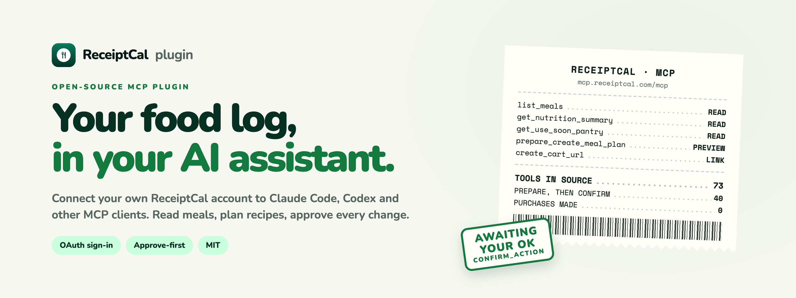
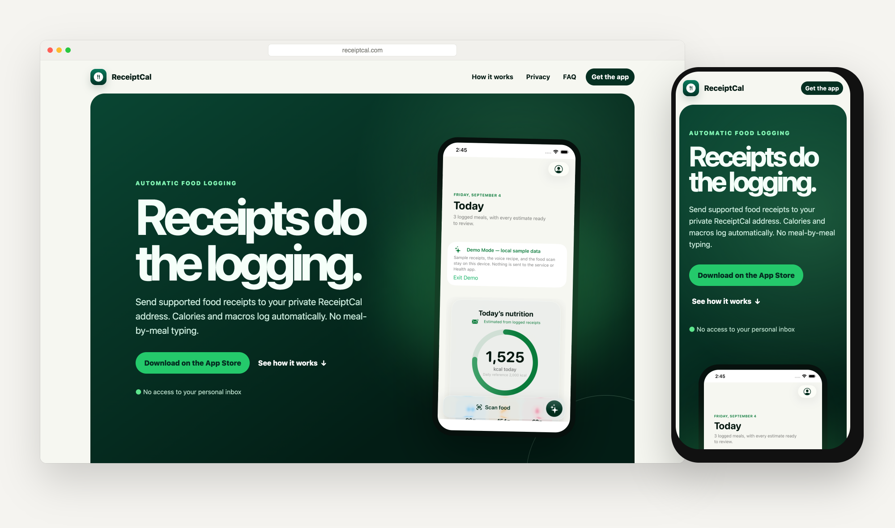
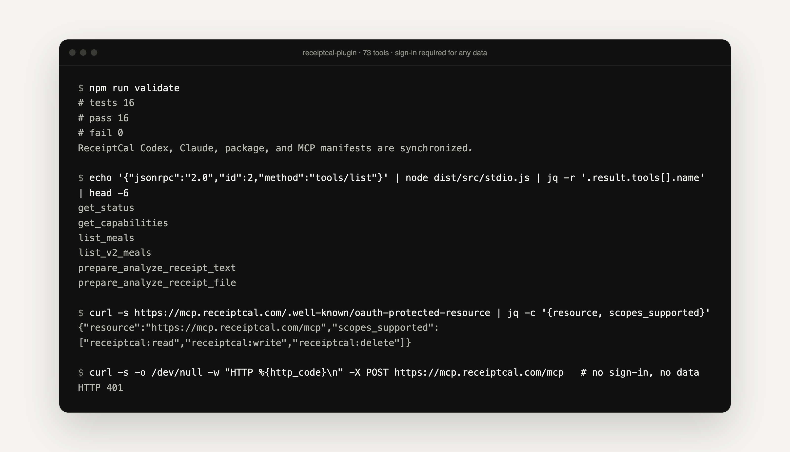

<p align="center">
  <a href="https://receiptcal.com/developers/">
    <picture>
      <source media="(prefers-color-scheme: dark)" srcset=".github/assets/banner-dark.png">
      
    </picture>
  </a>
</p>

<p align="center">
  <strong>Receipts do the logging. Your assistant does the thinking.</strong><br>
  The open-source plugin that connects your ReceiptCal account to Claude Code, Codex and other MCP clients, so you can ask about your meals and plan what to cook next.
</p>

<p align="center">
  <a href="https://receiptcal.com"><strong>ReceiptCal</strong></a> ·
  <a href="https://receiptcal.com/developers/"><strong>Developer docs</strong></a> ·
  <a href="#install"><strong>Install</strong></a> ·
  <a href="VALIDATION.md"><strong>Validation</strong></a> ·
  <a href="CONTRIBUTING.md"><strong>Contribute</strong></a>
</p>

<p align="center">
  <a href="LICENSE"></a>
  
  <a href="https://github.com/mihirkavi/receiptcal-plugin/actions/workflows/validate.yml"></a>
  
</p>

<p align="center">
  <a href="https://receiptcal.com"></a>
  <br><sub>The <a href="https://receiptcal.com">ReceiptCal</a> app logs food from receipts. This plugin brings that log into your AI assistant. The app preview shows demo-mode sample data.</sub>
</p>

## Why ReceiptCal plugin

Food logging apps ask you to type every meal. ReceiptCal skips that: you send a supported restaurant or delivery receipt to your private ReceiptCal address, and calories and macros log themselves. The log fills up on its own, but you still want help using it: what did I eat this week, what can I cook from my pantry, what should go on the grocery list?

**This plugin lets your AI assistant answer those questions from your real ReceiptCal log.** You sign in on ReceiptCal's own page, the assistant reads what it needs, and any change it suggests (a meal plan, a pantry update, a cart) is shown to you as a preview first.

<table>
  <tr>
    <td width="33%" valign="top">
      <h3>🧾 Starts from your log</h3>
      Meals, nutrition summaries, pantry, meal plans and grocery lists come from your account, with sources and uncertainty kept intact.
    </td>
    <td width="33%" valign="top">
      <h3>✅ You approve changes</h3>
      40 of the 73 tools only <em>prepare</em> an action. Nothing changes until you confirm, and each preview is single-use and expires.
    </td>
    <td width="33%" valign="top">
      <h3>🔐 Sign in, never paste</h3>
      OAuth with PKCE on ReceiptCal's page. No password or token in chat. Shopping tools build a cart link; they never buy anything.
    </td>
  </tr>
</table>

## Ask it things like

```text
Summarize my recent ReceiptCal meals.
Recommend a meal from my pantry, and tell me what's about to expire.
Plan three dinners this week and draft the grocery list. Show me before saving.
Analyze this receipt with ReceiptCal.
```

## Install

**Claude Code**

```sh
claude plugin marketplace add mihirkavi/receiptcal-plugin
claude plugin install receiptcal@receiptcal-plugins
```

**Codex**

```sh
codex plugin marketplace add https://github.com/mihirkavi/receiptcal-plugin.git
codex plugin add receiptcal@receiptcal-plugins
```

Then connect your account through the host's MCP sign-in flow. **Any other MCP client** that supports OAuth and Streamable HTTP can use the hosted endpoint directly:

```json
{ "mcpServers": { "receiptcal": { "type": "streamable-http", "url": "https://mcp.receiptcal.com/mcp" } } }
```

You need a ReceiptCal account; create one in the [iPhone app](https://apps.apple.com/us/app/receiptcal/id6793719739). Workspace or plan policies can restrict custom connections. See [Claude marketplace docs](https://code.claude.com/docs/en/plugin-marketplaces) and [OpenAI plugin docs](https://developers.openai.com/plugins/build/plugins).

## What's inside

<p align="center">
  
  <br><sub>Real output. Without signing in, the hosted server returns <code>401</code> and no data.</sub>
</p>

| | Area | Example tools | |
| --- | --- | --- | --- |
| 🍽️ | **Meals and nutrition** | `list_meals`, `get_nutrition_summary`, `prepare_analyze_receipt_text` | ✅ |
| 🥫 | **Pantry** | `get_inventory`, `get_use_soon_pantry`, `prepare_intake_inventory` | ✅ |
| 📅 | **Planning and recipes** | `get_current_meal_plan`, `prepare_create_meal_plan`, `list_recipe_cards` | ✅ |
| 🛒 | **Shopping handoff** | `resolve_amazon_products`, `create_cart_url`, `prepare_create_recipe_cart` | ✅ Link only |
| 🧠 | **Preferences and memory** | `get_food_profile`, `list_safety_constraints`, `list_memories` | ✅ |
| 🤝 | **Community recipes** | `prepare_contribute_recipe`, `get_recipe_sharing` | 🧪 Gated |
| ✅ | **Approval** | `confirm_action`, `cancel_action` | ✅ |

<details>
<summary><strong>What stays in the phone app</strong></summary>
<br>

Camera capture and barcode scanning, Apple Health and Health Connect permissions and writes, meal-photo upload, live voice audio, in-app subscriptions, and notifications are native app features. The plugin never claims to run them. The full list is `DEVICE_ONLY_CAPABILITIES` in [`src/capabilities.ts`](src/capabilities.ts).

</details>

## Develop locally

Node.js 22+. No backend checkout needed; tests use synthetic data and mocked responses.

```sh
git clone https://github.com/mihirkavi/receiptcal-plugin.git
cd receiptcal-plugin
npm ci
npm run validate          # typecheck, 16 tests, build, manifest sync
npm run configure:local   # optional: writes an ignored .mcp.local.json for the stdio connector
```

<details>
<summary><strong>Local connector, auth and code map</strong></summary>
<br>

- `npm run auth -- login` / `npm run auth -- logout` sign the local connector in and out. Enter credentials only in your own terminal. Tokens go to the macOS Keychain where available, or a permission-restricted local file.
- The local connector can upload receipt files only from allowed roots (default: its working directory and Downloads). Set `RECEIPTCAL_ALLOWED_FILE_ROOTS` to a dedicated test folder.
- `src/capabilities.ts` is the typed capability registry, `src/server.ts` implements the MCP tools, and `src/api-client.ts` calls the versioned ReceiptCal APIs.
- To add a capability: extend the registry, add schema and behavior tests, run `npm run validate`, and open a pull request. See [CONTRIBUTING.md](CONTRIBUTING.md).
- The portable `plugin.json` and `mcp.json` are canonical; `.codex-plugin/` and `.claude-plugin/` support current hosts.

</details>

## Honest status

- **Developer preview, version 0.1.0.** Distributed directly on GitHub. It is **not** an approved listing in the OpenAI plugin directory and is not published to npm or the MCP Registry.
- **Source is ahead of production.** The source defines 73 tools; the [developer docs](https://receiptcal.com/developers/) list 60 MCP tools as live today. Some depend on service rollout, and community recipes remain gated. A tool in source does not prove it is available.
- **Not certified end to end.** Tests, manifest checks and anonymous OAuth checks pass ([VALIDATION.md](VALIDATION.md)); a full signed-in journey in every host is not certified.
- **A few reads have side effects:** some recommendation and quality reads may update derived records.
- **Nutrition values are estimates** with provenance and uncertainty, for everyday tracking. Not medical advice.

## Privacy, support and license

[Service privacy](https://mcp.receiptcal.com/privacy) · [Service terms](https://mcp.receiptcal.com/terms) · [Security reporting](SECURITY.md)

File code bugs with synthetic reproduction steps in [GitHub issues](https://github.com/mihirkavi/receiptcal-plugin/issues). Never include receipts, health details, chats, account identifiers, tokens or screenshots with personal data; account-specific reports belong in ReceiptCal's private support flow.

The [MIT License](LICENSE) covers this repository only. It grants no rights to the private app and backend, customer data, third-party content or ReceiptCal trademarks.

<p align="center">
  <br>
  <br>
  <sub><strong>ReceiptCal</strong> · Receipts do the logging.</sub>
</p>
